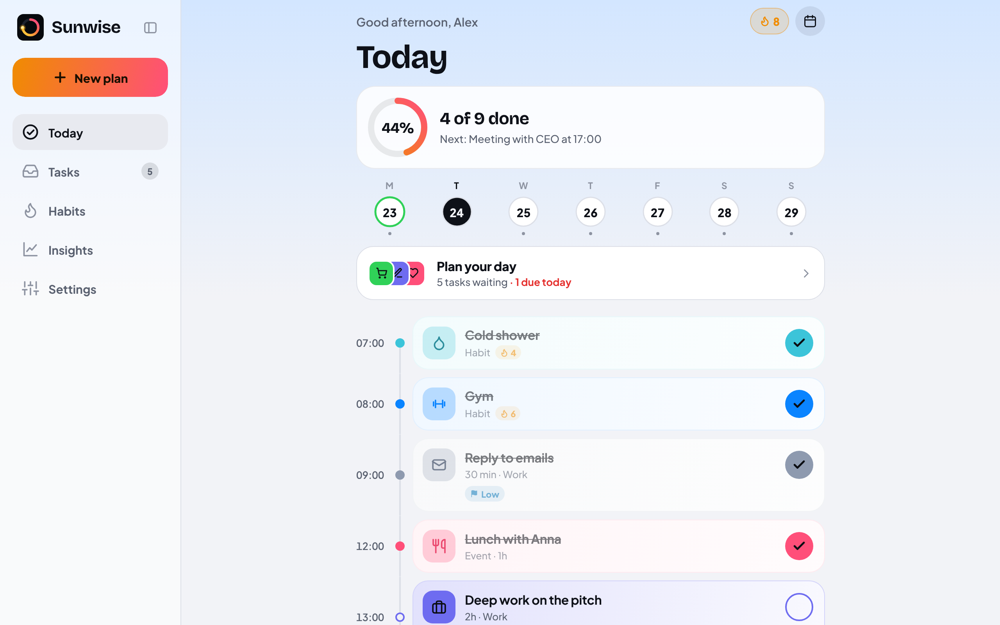
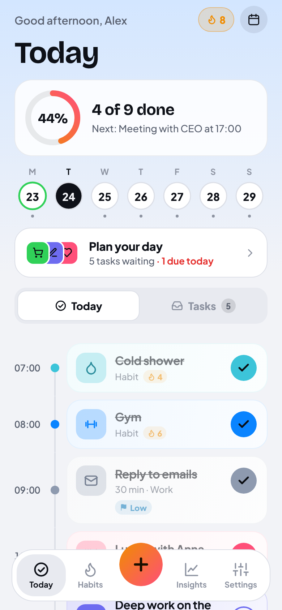
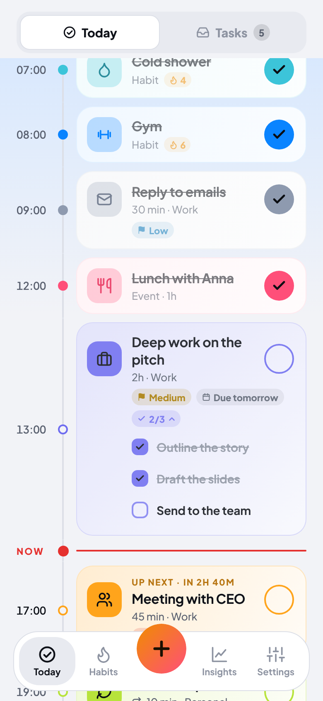
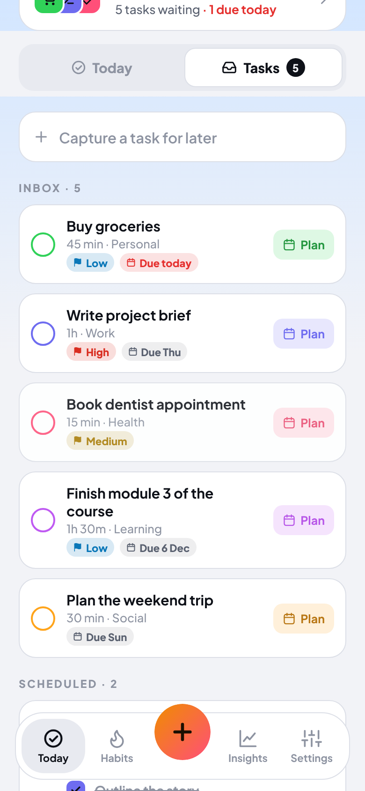
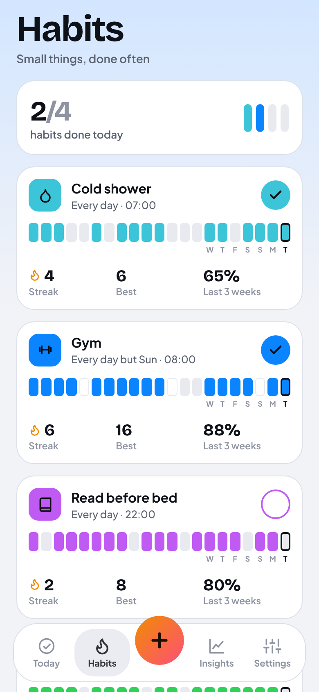
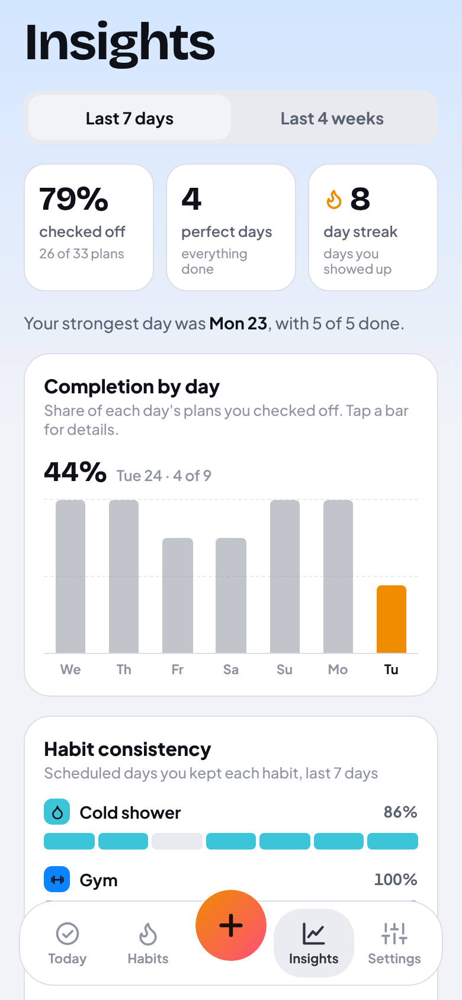
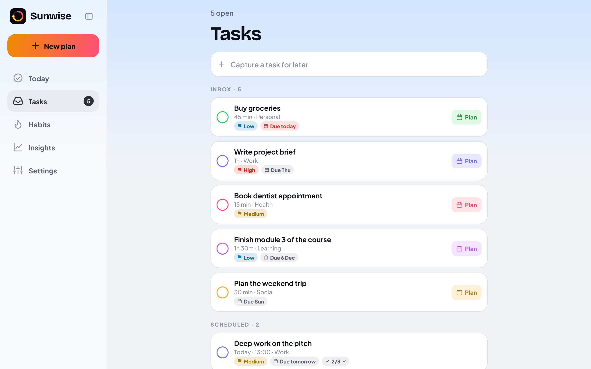
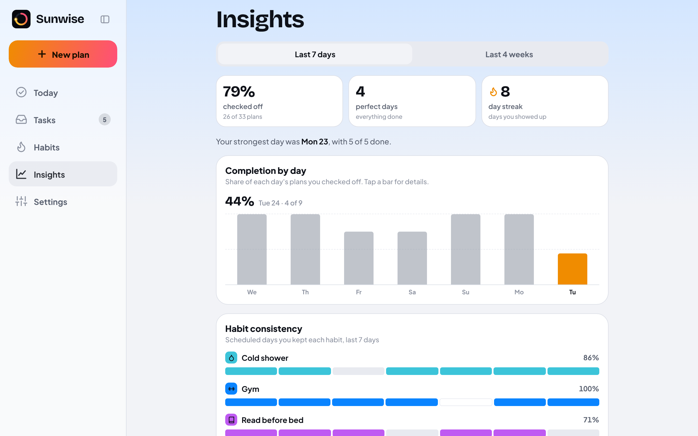
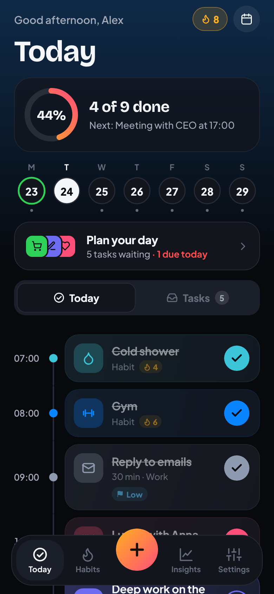

# Sunwise

A day planner that puts scheduled plans, habits and to-dos on one Today timeline, with streaks and weekly insights. One codebase runs on Android, iOS and the web.

> The source code is private. This repo holds the description, download links and releases.

## Try it

| Platform | Link |
|---|---|
| Web | **[sunwise-phi.vercel.app](https://sunwise-phi.vercel.app)** |
| Android | **[Download the latest APK](../../releases/latest)** |

### Installing the APK on Android
1. Open the link above on your phone and download `planner.apk`.
2. When Android asks, allow your browser to install unknown apps.
3. Open the file and tap **Install**.

The APK is sideload-only for now (not on the Play Store).

## Features

- **Today**: a greeting that follows the time of day, a progress ring for the day, a week strip, and a timeline of coloured cards with a NOW marker. Tap or swipe a card to check it off.
- **Plan your day**: unscheduled tasks wait in an inbox until you give them a time slot. The app suggests free times.
- **Tasks**: quick capture, overdue, scheduled and done lists. Each task can have a priority (Low / Medium / High) and a deadline.
- **Habits**: three weeks of history per habit, with current and best streaks.
- **Insights**: completion by day, perfect days, streaks, habit consistency, and work done by category.
- A centre **+** button adds a task, habit or event from any screen.

Plans are saved on your device. There are no accounts. To keep plans the same on more than one device, turn on sync in Settings: it gives you a secret code to enter on your other devices. Plans are encrypted on the device before they're sent, so the server never sees them.

## What I built it with

- Expo / React Native + TypeScript (Android, iOS and web from one codebase)
- On-device storage, plus optional end-to-end encrypted sync through Supabase
- A GitHub Actions workflow that builds and publishes the Android APK when I start it
- Web version hosted on Vercel

## Screenshots

<picture><source media="(prefers-color-scheme: dark)" srcset="screenshots/wide-today-dark.png"></picture>

<table>
  <tr>
    <td align="center"><picture><source media="(prefers-color-scheme: dark)" srcset="screenshots/phone-today-dark.png"></picture> Today</td>
    <td align="center"><picture><source media="(prefers-color-scheme: dark)" srcset="screenshots/phone-checklist-dark.png"></picture> Checklists</td>
    <td align="center"><picture><source media="(prefers-color-scheme: dark)" srcset="screenshots/phone-tasks-dark.png"></picture> Tasks</td>
    <td align="center"><picture><source media="(prefers-color-scheme: dark)" srcset="screenshots/phone-habits-dark.png"></picture> Habits</td>
    <td align="center"><picture><source media="(prefers-color-scheme: dark)" srcset="screenshots/phone-insights-dark.png"></picture> Insights</td>
  </tr>
</table>

<table>
  <tr>
    <td align="center"><picture><source media="(prefers-color-scheme: dark)" srcset="screenshots/wide-tasks-dark.png"></picture> Tasks page with the side bar</td>
    <td align="center"><picture><source media="(prefers-color-scheme: dark)" srcset="screenshots/wide-insights-dark.png"></picture> Insights on a wide screen</td>
  </tr>
</table>

The screenshots above follow your GitHub theme. The app has both, and follows the device unless you pick one in Settings:

<table>
  <tr>
    <td align="center"></td>
    <td align="center"></td>
  </tr>
</table>
